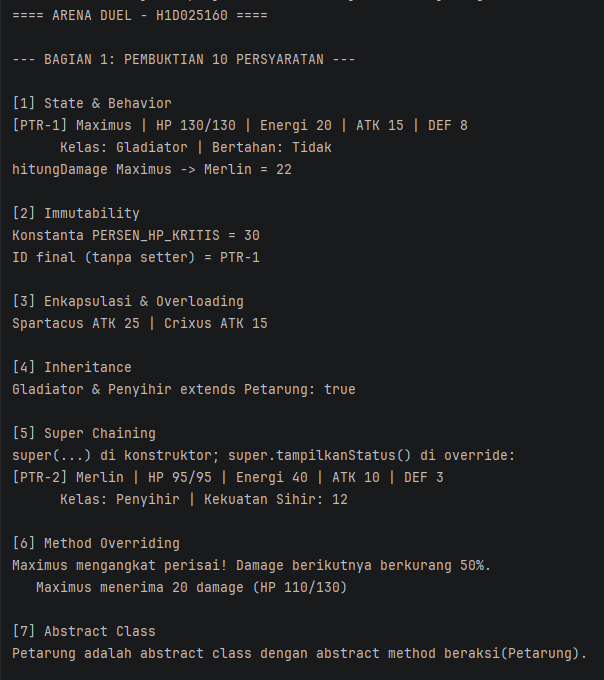
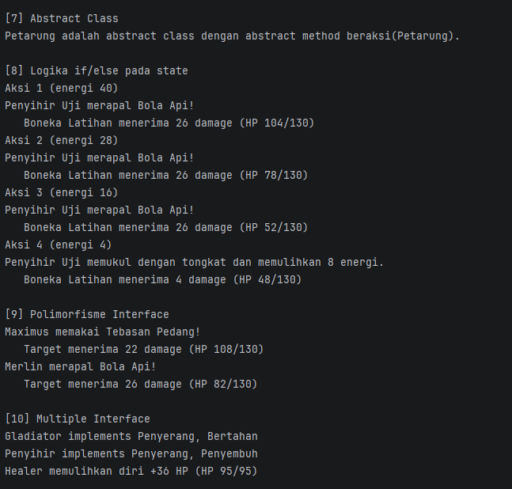
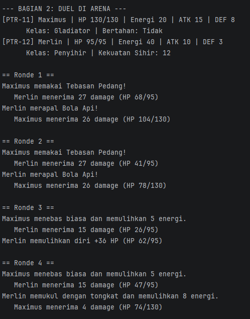
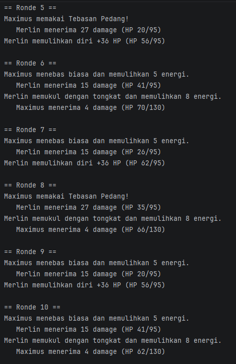
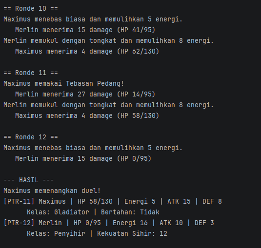

# Arena Duel – Responsi Akhir PBO

## Identitas
- **Nama**   : Adyan Damar Farizqi
- **NIM**    : H1D025160
- **Tema**   : Game – Arena Duel

## Deskripsi
Dua petarung (Gladiator dan Penyihir) bertarung bergantian di arena sampai salah satu kalah.
Program membuktikan 10 persyaratan OOP (Bagian 1), lalu menjalankan duel otomatis (Bagian 2).

## Struktur Class
| File | Peran |
|---|---|
| `Petarung.java` | Superclass **abstract** (abstract method `beraksi`) |
| `Gladiator.java`, `Penyihir.java` | Subclass |
| `Penyerang.java`, `Bertahan.java`, `Penyembuh.java` | Interface |
| `Main.java` | Class utama + alur pengujian |

## Cara Compile & Run (Terminal)
```bash
cd Arena-Duel
javac *.java
java Main
```

## Screenshot Luaran




